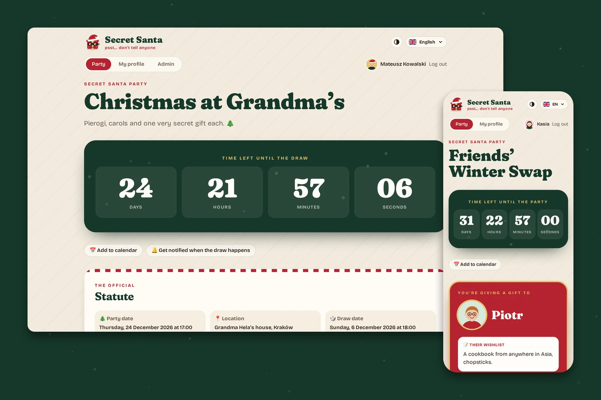
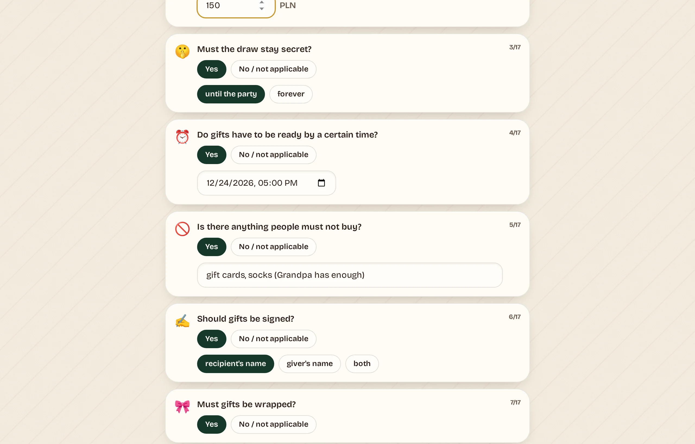
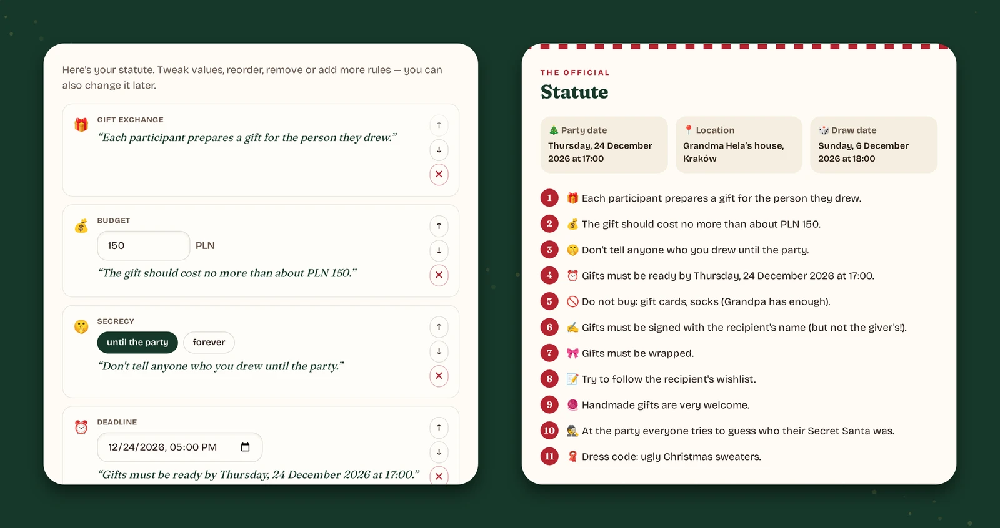
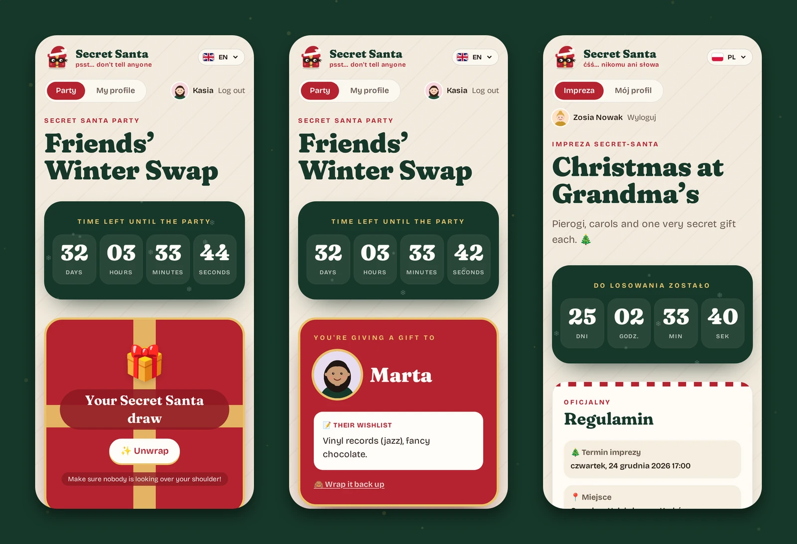
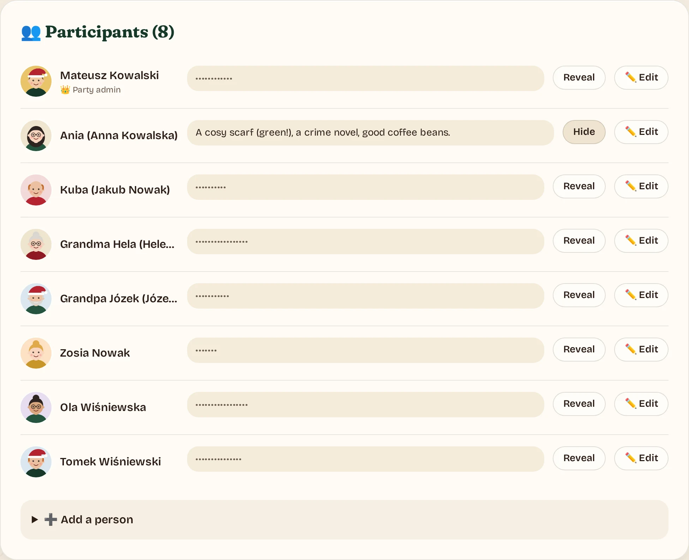
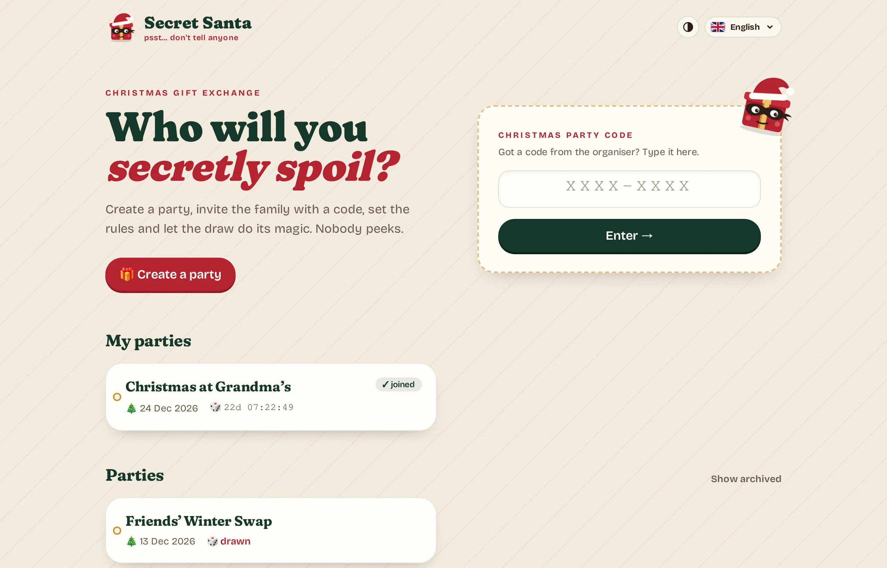

# Secret Santa 🎅

**Self-hosted Secret Santa for families and friend groups — psst… don't tell anyone.**
Create a party, invite everyone with a code, write the rules together and let the draw do its
magic. Polish 🇵🇱 and English 🇬🇧 — more languages can be added (see below).



## Why it's nice

- 🔑 **One code, no accounts.** Every party has a _Christmas Party Code_. Family members type it
  in, pick a name, optionally set a passcode — done. No e-mails, no sign-ups.
- 📜 **Rules written for you.** A short questionnaire (budget? secret until the party? anything
  not to buy? signed gifts?) turns into a nicely worded statute. Anything that doesn't apply
  simply isn't there. Tweak, reorder or add your own rules any time.
- ⏳ **A big countdown and an automatic draw.** At the set time everyone gets their person — or
  the organiser presses _Draw now_.
- 💑 **Couples won't draw each other.** Ask not to draw someone; once they accept, it works both
  ways.
- 🎁 **Unwrap your result.** Your person, their photo and their wishlist, hidden until you tap.
- 🙈 **No spoilers for the organiser.** Admins can edit everything, but wishlists stay hidden
  behind _Reveal_ and nobody — not even the admin — can see who drew whom.





On the phone — wrapped, unwrapped, and in Polish:



Organiser view — wishlists stay hidden until you really need them:





## All features

- **Parties behind a code** — every party has a "Christmas Party Code" (random like `K7QM-4XPA`
  or chosen by the admin). The home page lists public parties (name + date only) and the parties
  you already joined in this browser.
- **Join in seconds** — name and/or nickname, optional (but recommended) passcode, profile picture,
  wishlist. No global accounts: you join each party separately.
- **Statute builder** — creating a party walks you through a questionnaire (budget, secrecy,
  deadline, things not to buy, signed gifts, wrapping, wishlists, theme, dress code…). Answers
  become nicely worded rules; anything that doesn't apply is left out. Edit, reorder, add custom
  rules later. Rules are rendered in the viewer's language.
- **Couples** — ask not to draw someone; it works both ways once the other person accepts.
  Admins can add pairs directly.
- **Big countdown** to the draw (then to the party). The draw happens **automatically** at the
  set time, or the admin can draw early. Everyone unwraps their result on the party page.
- **Party admin** (password required): edit settings, date, location, code, rules, members
  (names, passcodes, admin flag, participation). Wishlists are hidden behind "Reveal" so admins
  don't spoil their own surprise. Archive / restore, delete. Nobody can see the assignments.
- **Website admin** at `/admin` (password from `.env`) can see and manage every party.
- **Add to Home Screen** on iPhone/Android gives a proper icon and opens full screen like an
  app (on iOS you log in once more inside the app — it doesn't share Safari's cookies).

## Running

```bash
cp .env.example .env        # set SITE_ADMIN_PASSWORD
docker compose up -d --build
```

The app listens on host port **8976**. Data (SQLite DB and avatars) lives in `./data`,
owned by uid 1000. Migrations run automatically on start.

### Nginx Proxy Manager

Add a proxy host for your domain (e.g. `santa.example.com`) → `http://<server-lan-ip>:8976`,
with an SSL certificate and Force SSL. Avatars are resized server-side (uploads up to 10 MB), so the default body-size
limit is fine.

`ORIGIN` in `.env` must match the public URL, otherwise form submissions are rejected
("Cross-site POST form submissions are forbidden"). Session cookies are `Secure`; for plain-HTTP
testing on a LAN IP set `COOKIE_SECURE=false` and `ORIGIN=http://<ip>:8976`.

## Development

```bash
npm install
npm run dev               # http://localhost:5173 (uses ./data/santa.db)
npm run check             # types
npx vitest run            # unit tests
npx playwright test       # end-to-end (builds and runs a preview server)
PW_BASE_URL=http://localhost:8976 PW_ADMIN_PASSWORD=… npx playwright test   # against a running instance
```

UI strings live in `scripts/messages.py` → `python3 scripts/messages.py` regenerates
`messages/{en,pl}.json`. After changing `src/lib/server/db/schema.ts` run `npm run db:generate`.

### Adding a language

The header has a language drop-down (flag + the language's own name), filled from
`src/lib/languages.ts`. To add e.g. German:

1. add `"de"` to `locales` in `project.inlang/settings.json`;
2. append `"de"` to `LANGS` in `scripts/messages.py`, add a German column to every entry and
   run `python3 scripts/messages.py`;
3. add a `de` entry (native name, flag, Intl tag, quotation marks) to `LANGUAGES` in
   `src/lib/languages.ts` and a flag SVG to `static/flags/` — `npm run check` fails until the
   entry exists.

Home-screen icons (`static/apple-touch-icon.png`, `static/icon-*.png`) are rendered from
`src/lib/assets/favicon.svg` by `npm run icons` — rerun it after changing the logo.

Screenshots are generated from demo data: `npm run screenshots` builds the app, seeds a
throwaway instance through the UI and rewrites `docs/screenshots/*.webp`.

See `CLAUDE.md`, `docs/decisions.md` and `docs/log.md` for architecture notes.
